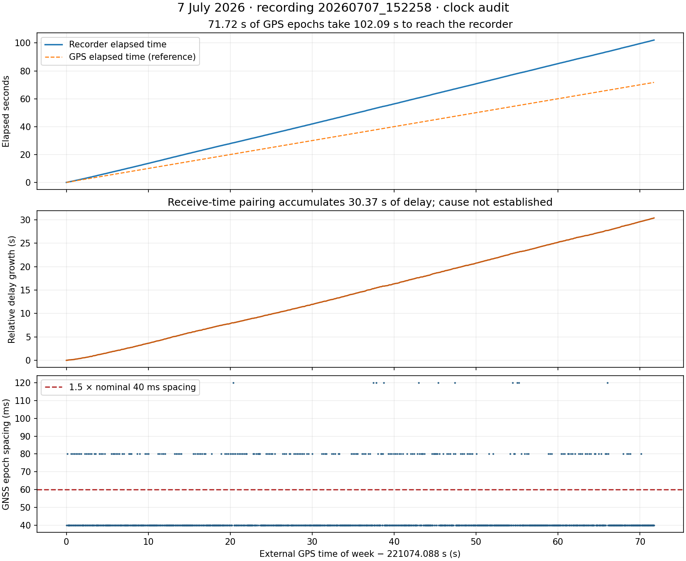
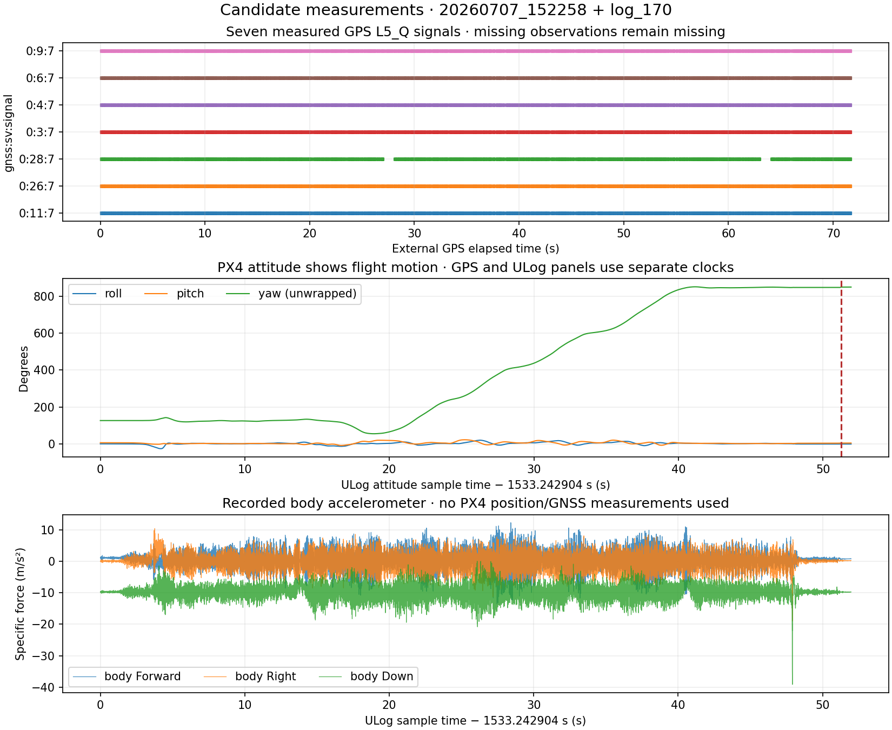

# Recorded-data candidates for detect2

Audit date: 3 November 2026. Source: `/home/borna/Documents/stored_flights`.
Inspected 18 ULogs and 24 saved synchronized-measurement streams, including CSV and structured NPY chunks. Original recordings were not modified. ULog reading was restricted to attitude, IMU, sensor selection/bias, vehicle status and landing state; no ULog GNSS or position measurements were read. This is an availability/timing audit, not detector validation.

## Recommended first pair

- External phases: `extra_gps/recordings/20260707_152258/synced_measurements.csv`.
- IMU/attitude: `flights/log_170_2026-7-7-15-25-22.ulg`.
- External receiver: 1,573 distinct epochs across 71.72 s; nominal 25 Hz, with 40/80/120 ms epoch spacing. Seven distinct GPS signals: PRNs 3, 4, 6, 9, 11, 26 and 28, all `gnssId=0, sigId=7`. The local u-blox decoder maps these to **GPS L5_Q**; the synthetic L1 wavelength must not be reused. Six or seven are present per epoch; PRN 28 has a longer individual gap.
- ULog: about 52 s, 9,854 `sensor_combined` samples (~190 Hz) and 1,040 supplied `vehicle_attitude` quaternions (~21 Hz). Body acceleration has no recorded clipping flags. The log contains flight movement, not only stationary attitude. Attitude reset counter changes 22→23 at boot time 1584.496462 s; integration windows must handle/exclude that reset. The largest logged accelerometer interval is 15.859 ms, and attitude sample spacing reaches about 100 ms, so existing synthetic IMU-gap assumptions also need review.
- Saved row attitudes match ULog attitudes closely when compared at their PX4 boot timestamps: median absolute Euler component difference 0.0086°, 95th percentile 0.0435°. There are 785 saved rows whose paired attitude boot times lie inside the ULog attitude range (~51.87 s). **This confirms the attitude/log pairing, not the carrier measurement-time alignment.** The separate `attitude_messages.csv` contains 10,292 complete attitude messages at roughly 100 Hz and is useful for checking the timing bridge.

## Timing must be repaired before replay

The external GPS epoch clock advances **71.72 s**, but `carrier_sync_time` advances **102.09 s**, and the paired PX4 boot timestamp advances **102.45 s**. Relative receive delay grows about **30.37 s** across the recording. This is consistent with queueing/processing backlog or another recording clock problem; its precise cause has not been established. The recorded nearest-attitude `time_offset` (median ~10.8 ms) measures receive-time proximity and does **not** demonstrate synchronized sensor measurement times. The paired boot timestamp even repeats/backsteps on seven transitions.

Use the external receiver's `gps_time` as the phase epoch clock. Establish and validate a measurement-time mapping to PX4 boot time independently; do not fit GPS epoch time to all delayed receive timestamps and treat the residual as sensor accuracy. The ULog boot UTC metadata may be a useful cross-check, but needs verification. Validate an offset independently or with held-out motion/phase consistency before drawing detector conclusions. Plot genuine time gaps; never synthesize phase across them.

Only nine 1 s bins in the whole phase recording satisfy a preliminary availability screen (at least 10 epochs, four common signals, no GNSS epoch gap >1.5×40 ms). This screen uses bins anchored at the first GPS epoch and is deliberately strict. It does not check physical synchronization, motion excitation, cycle slips, uncertainty or detector model fit, so it is not a count of usable detector decisions. Other bin alignment/gap policies can give different counts.

## Other candidates

| Recording | Phase content | Assessment |
|---|---|---|
| `20260707_131746` | 426 epochs / 29.60 s, 100 distinct signals across constellations/bands | Useful raw-phase inspection; gappy and ~18.85 s receive-delay variation. No matching ULog among supplied files. Signal count is not satellite count. |
| `20260707_133533` | 340 epochs / 24.56 s, 109 distinct signals | Similar phase-only candidate; ~17.08 s receive-delay variation, no supplied matching ULog. |
| `archive/20260707_133844` | 351 epochs / 25.88 s, nine GPS L5_Q signals | Phase-only candidate, no supplied matching ULog. |
| `archive/20260707_152458` | 960 complete epochs / 43.96 s, seven GPS L5_Q signals | Recorded boot range 1639.352–1702.303 s is after log_170 ends at 1585.219 s; cannot pair directly. One truncated row excluded. |
| `20260806_111120/synced_measurements/` | Structured NPY, 2,394 epochs / 94.721 s, 18 GPS/Galileo L1/E1 signals | Useful phase reference; nominal 25 Hz with much steadier receive timing than July, although a ~1 s timing excursion needs checking. No August ULog in supplied flights. |
| `20260818_114639/synced_measurements/` | Structured NPY, 356 epochs / 20.199 s, 16 distinct signals | Secondary phase inspection only; large gaps/timing issue and no matching ULog. |
| `20260818_132905` | Some L5 phases, mostly empty epochs, very large gaps across days and conflicting duplicate epochs | Must split and inspect recording segments. Large file size is not evidence of a complete flight. No matching ULog. |
| `20260826_111612` | 101 epochs / 8.56 s, nine L5_Q signals | Short phase-only candidate; no matching ULog. |

`log_169` is only about 12 s and has no external-phase interval identified alongside it. The earlier June/July 2 ULogs are useful for IMU-only checks; available archived July 2 external sessions have no saved phase stream to pair with them.

## Files that should not be treated as raw detector input

- `20260707_143516`, `20260707_144702`, `archive/20260707_142002`, `archive/20260707_142653`, `20260806_112226`, `20260806_113010`, `20260818_124910`, `20260818_130330` and `20260821_153900`: their exported wide CSV carrier columns are entirely empty. Some associated event logs contain other signal IDs. The local wide writer is configured for GPS signal 7 and drops unmatched signal IDs, which is consistent with this loss. Attitude rows alone cannot replace the missing phases.
- `20260806_112147`, `20260806_114048` and `20260821_153522`: synchronized CSV is header-only. Empty NPY synchronized streams are also not phase recordings.
- Short archived starts (`130140`, `131716`, `152222`) contain only four GPS epochs each, below the current 10-sample window minimum.
- `*_redetrended_*.csv` are alternate processing of the same session. All five July 152258 variants preserve raw `carrier_*` columns identically; use the original file and let detect2 remove its own per-window quadratic trend. Do not feed the older moving-mean `detrended_*` values into the paper detector.
- `detection_events.csv` contains outputs of the older threshold detector. These are **not independent spoofing ground truth** and do not contain a complete raw phase record.

## Missing information before a defensible detector run

The saved phase streams retain carrier cycles, signal IDs and GPS time of week, but do not retain complete raw receiver packets, pseudorange/Doppler, carrier validity, lock time, half-cycle/slip indicators or per-observation carrier uncertainty. The inspected source tree contains CSV, structured NPY, manifest JSON and ULogs; no external UBX/RINEX observation or navigation files were found. The collection code currently filters validity before saving but discards those flags; that cannot certify continuity retrospectively.

We also need nominal satellite line-of-sight geometry (external-receiver sky directions or ephemerides plus approximate receiver location), a verified measurement clock mapping, the physical IMU-to-external-antenna offset and a measured noise model. Geometry is not present in these recordings. Obtain receiver/location information independently of the ULog GNSS, as requested. Confirm whether any interval has independent benign/spoofed experiment labels; old detector events cannot supply them.

The next concrete step is a **clock-alignment and measurement-quality inspection of July 152258 + log_170**, followed by plots of short-window IMU displacement and carrier phase on the verified common time axis. No detector classifications have been produced from these flight recordings in this audit.

## Audit outputs and method

- [All synchronized streams as CSV](recordings.csv)
- [Detailed inventory and selected ULog topics](inventory.json)
- [Both figures as PDF](recording_audit.pdf)

Distinct epochs were grouped by saved GPS time; multi-signal rows were combined by signal ID, with duplicate conflicts counted. Malformed incomplete rows were excluded explicitly. Rates are median interval estimates, not guarantees of continuity. NPY was read without pickle support. Large unrelated attitude-only CSVs were not fully loaded. Phase second differences in the JSON are unnormalized diagnostics over irregular intervals and must not be interpreted as cycle-slip evidence.
